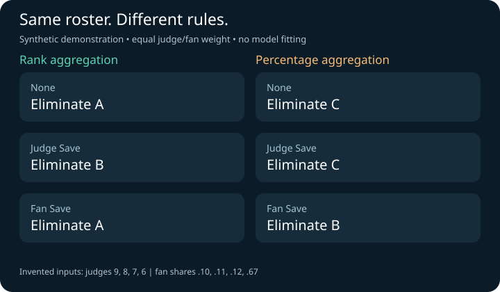
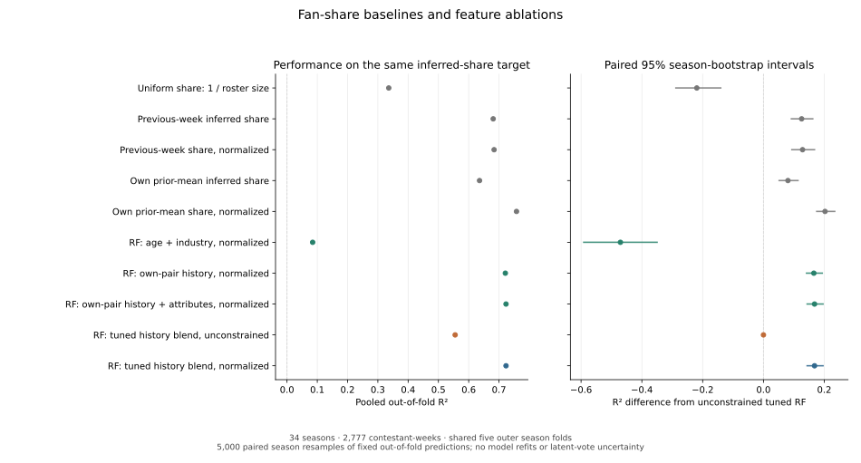

# DWTS Voting Analysis

**How do voting rules shape competition outcomes when audience votes are hidden?**

The software implementation and subsequent extensions of Team 2627761's DWTS
study for the 2026 MCM Problem C. Yike Chen participated in the original team
research. The workflow infers latent fan support, compares voting rules, and
studies associations between scores, contestant features and partner history.

**Project lead: Yike Chen.** The original study is credited to Team 2627761.

[Documentation](#documentation) · [Methods](docs/METHODS.md) · [Study results](docs/STUDY_RESULTS.md) · [Validation](docs/VALIDATION_RESULTS.md) · [Run guide](docs/RUNNING.md)

## Documentation

| Guide | What it covers |
|---|---|
| [Prediction, recovery and policy validation](docs/VALIDATION_RESULTS.md) | Temporal exit backtesting, known-truth simulation and multi-objective policy robustness. |
| [Methods and assumptions](docs/METHODS.md) | Data processing, Bayesian inference, voting rules and validation. |
| [Study results and figures](docs/STUDY_RESULTS.md) | Baselines, feature ablations, posterior policy comparisons and sensitivity. |
| [Earlier results and report comparisons](docs/RESULTS.md) | Preserved v5 metrics, numerical differences and interpretation limits. |
| [Running the study](docs/RUNNING.md) | Installation, data, the demo and the full research workflow. |
| [Research team and sources](docs/PROVENANCE.md) | Original team research, project leadership and the current code edition. |

The [documentation index](docs/README.md) also links data sources and experiment configurations.

## Research questions

- What fan-support patterns are compatible with public scores and elimination outcomes?
- How do rank and percentage aggregation, judge saves and fan saves change weekly outcomes?
- How are judge scores and inferred fan support associated with contestant and partner features?

The workflow combines Bayesian inverse modelling, a PyMC reference model and a
Numba Metropolis–Hastings engine, explicit rule simulations, nested season-grouped
random forests, OLS and SHAP. Configurations and input hashes record each
experiment's assumptions. Exact rank-tie handling and canonical partner identities
address two demonstrated implementation issues.



## Quick start

Python 3.12 is the verified environment. Run commands from the repository root.

```bash
python -m venv .venv
source .venv/bin/activate
# Windows PowerShell: .venv\Scripts\Activate.ps1
python -m pip install -r requirements-v4-verified.txt
python -m pip install --no-deps -e ".[test,audit]"
python -m dwts.demo --out outputs/my-demo
python -m pytest -q
```

The demo uses four invented contestants and fan shares. At equal judge/fan weight,
the rank rule eliminates A and the percentage rule eliminates C. It writes a CSV,
JSON and SVG, and refuses an existing output directory.

Default tests are self-contained. Tests requiring official data or archived
experiments are explicitly deselected. GitHub Actions runs the self-contained
tests and synthetic demo.

## Research findings

The extended study covers 34 seasons and 2,777 contestant-weeks. Fourteen
fan-share models share five outer season folds; RF history weights are selected
in three inner season folds. Every model predicts the same inferred fan-share
target. Weekly normalization constrains predicted shares to sum to one.

| Fan-share model | Out-of-fold R² | Out-of-fold RMSE |
|---|---:|---:|
| Unconstrained tuned RF | 0.555265 | 0.063599 |
| Weekly-normalized tuned RF | 0.723234 | 0.050172 |
| Weekly-normalized own-history mean | 0.757838 | 0.046930 |

The simple normalized history baseline has the best point score among the
declared models. Both RF pipelines select history weight zero in every outer
fold, so these results do not establish an incremental cross-season partner
effect. This is exploratory internal validation of whole-season latent targets;
the normalization hypothesis arose from this dataset. It does not measure future
true-vote prediction. RMSE is in share units.



The policy study propagates 2,048 joint posterior draws through 18 policies on
291 eligible weekly rosters. Judge saves do not universally reduce the declared
controversial-week fraction. A separate nine-season analytic prior-scale study
shows invariant rank-policy results but sensitivity in percentage-policy
outcomes. [Study results](docs/STUDY_RESULTS.md) provide three figures, paired
comparisons, assumptions and aggregate data. [Earlier results](docs/RESULTS.md)
preserve the six-task v5 snapshot and original-report comparisons.

## Prediction, recovery and policy validation

Three additional studies test the limits of the inference and policy results:

- **Temporal backtesting:** a separate normalized exit model selects settings on
  seasons 3–20, then uses current judges' scores to predict each eligible exit
  in seasons 21–27. The
  33 eligible weeks represent six seasons; season 26 has no qualifying
  single-exit weeks. Bayesian log loss is 1.948 versus 2.154 for uniform
  probabilities and 1.621 for the best point-scoring past-judges baseline.
  The data support no demonstrated Bayesian advantage over stronger baselines.
- **Known-truth recovery:** 192 independently generated seasons support 384
  fits and 64 larger-particle checks. Matched-model intervals cover about 95–96%
  of generated contestant-week shares, but narrower priors reduce coverage to
  about 64–67%. Independent coverage probes remain imprecise, and some point
  rankings are sensitive to finite-particle error.
- **Multiple policy objectives:** 18 policies are compared on six declared
  objectives across separate matched cohorts. Seven of 153 policy pairs show
  baseline mean dominance; none retains dominance throughout either of the
  declared sensitivity grids. Tradeoffs and assumptions remain visible.

[Validation results and three figures](docs/VALIDATION_RESULTS.md) provide the
protocols, uncertainty intervals and aggregate data. These historical data were
previously examined. The chronological replay is a retrospective backtest;
independent prospective confirmation remains untested.

## Run an experiment

Read [data sources](data/SOURCES.md), then obtain the official COMAP CSV:

```bash
python scripts/download_data.py
python -m dwts prepare --out outputs/prepared
python -m dwts run --config configs/smoke.json --out outputs/smoke --skip-attribution
```

The smoke configuration checks execution with short chains. For the full study:

```bash
python -m dwts run --config configs/study.json --out outputs/my-study
```

Research estimates require passing sampling diagnostics; see the [run guide](docs/RUNNING.md).

After a full run passes diagnostics:

```bash
python -m dwts.analysis --source outputs/my-study --out outputs/my-analysis
```

This compares voting rules under declared save mechanisms, fits OLS using prior
judge shares, and reports week and event rates with explicit denominators.
Undefined multi-exit save cases remain unscored. It reuses fitted posterior means.
Successful standalone analysis returns exit **0**. Optional comparisons with the
original report are enabled with `--compare-reference` and have a separate status;
see the [run guide](docs/RUNNING.md).

## Interpretation limits

- Fan shares are latent estimates; true audience vote totals are unavailable.
- Whole-season fan inference supports retrospective analysis. A separate model has chronological backtests; independent prospective performance remains unevaluated.
- SHAP and feature importance describe associations; they do not identify causal partner effects.
- Rule comparisons retain each week's observed roster. Complete alternative-season trajectories are not simulated.
- RF/OLS use posterior means. The separate policy study propagates joint posterior draws; its intervals remain conditional on model assumptions.

## Repository map

```text
dwts/                 Models, voting rules, analysis and synthetic demo
configs/              Experiment and sensitivity configurations
scripts/              Data acquisition and validation utilities
tests/                Scientific regression tests and repository checks
results/              Aggregate benchmarks, policy studies and preserved v5 metrics
docs/                 Methods, results, sources and running instructions
.github/              Test workflow and contribution templates
```

## Research team and sources

Original study: Team 2627761 (2026), *Modeling Fairness in Competitive Voting
Systems: A Bayesian Approach to Infer Fan Support and Evaluate Contest Dynamics
in DWTS*. Yike Chen was a member of the original research team; the study is
credited to the full team. [Software provenance](docs/PROVENANCE.md) distinguishes
the current code edition and later extensions from the competition-time work.

The report, raw dataset and posterior chains are not bundled. No open-source
license has been granted; see [license status](LICENSE_STATUS.md).
