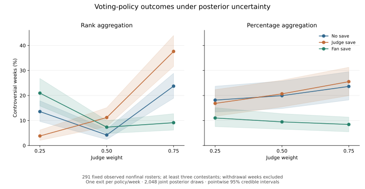
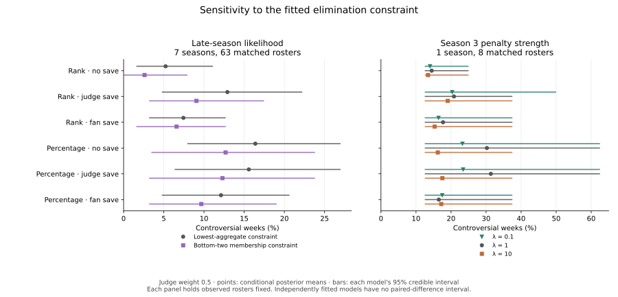

# What the DWTS experiments show

Project lead: **Yike chen**. This project extends Team 2627761's 2026 MCM DWTS
study; the original research is credited to the full team. These results come
from the current software edition, prepared with AI-assisted development.
[Research and software provenance](PROVENANCE.md) distinguishes the two stages.

The questions are practical: what helps explain inferred fan support, how do
voting rules change weekly decisions, and which conclusions depend on modeling
assumptions? The experiments are **exploratory internal validation**. The
normalization hypothesis arose from examining this same dataset; the grouped
folds and intervals do not provide independent confirmation.

## Study design

The official data cover 34 seasons, 335 weeks and 2,777 active contestant-weeks.
All 34 source fits passed the declared sampling gates: maximum R-hat **1.0053**,
minimum bulk ESS **672** and minimum tail ESS **1,405**.

| Experiment | Population and method |
|---|---|
| Fan-share benchmarks | All 2,777 contestant-weeks; 14 pipelines on shared five outer season folds; RF uses 300 trees and three inner season folds. |
| Voting-rule uncertainty | 291 nonfinal weekly rosters with at least three contestants and no withdrawals; 18 policies, each prescribing one exit. |
| Posterior propagation | 512 stratified draws from each of four chains; 2,048 joint draws per season preserve dependence between contestants and weeks. Independently fitted seasons are combined with seeded permutations. |

## 1. A simple history baseline outperforms the forest


All models predict the **same frozen posterior-mean fan share**. Weekly
normalization divides predictions by their sum over the active roster; the target
and evaluation rows remain unchanged. Raw and normalized RF pipelines each select
their history blend in inner folds. The same normalization is also applied to
the simple history baselines.

| Pipeline | Pooled out-of-fold R² | RMSE, share units |
|---|---:|---:|
| Uniform share, 1 / roster size | 0.3360 | 0.07771 |
| Previous-week inferred share, normalized | 0.6839 | 0.05362 |
| Own prior-mean inferred share, normalized | **0.7578** | **0.04693** |
| Tuned RF, unconstrained predictions | 0.5553 | 0.06360 |
| Tuned RF, normalized predictions | 0.7232 | 0.05017 |

Normalization improves RF R² by **0.1680**, with a paired 95% season-bootstrap
interval of **[0.1413, 0.1983]**. However, normalized RF remains below normalized
own-history means: ΔR² **−0.0346 [−0.0510, −0.0191]**. Both tuned RF pipelines
selected cross-season history weight zero in every outer fold, yielding the same
predictions as the fixed own-pair-history-plus-demographics ablation.

The structural sum-to-one constraint and a fair history baseline matter more than
forest complexity in this experiment. The figure's intervals use **5,000 paired
whole-season bootstrap resamples of fixed out-of-fold predictions**; models are
not refitted and latent-target uncertainty is not included.

[All 14 pipelines](../results/study_benchmarks/metrics.csv) ·
[Paired differences](../results/study_benchmarks/paired_differences.csv) ·
[Benchmark protocol](../results/study_benchmarks/protocol.json)

## 2. Save mechanisms depend on the aggregation rule



A controversial exit has either judge rank ≤ 2 and fan rank > n/2, or judge rank
> n − 2 and fan rank ≤ n/2, where rank 1 is best and ties use average ranks.
This operational definition measures a particular judge–fan disagreement; it
does not define fairness in general.

At judge weight 0.5, propagating posterior uncertainty gives:

- **Rank aggregation:** no-save controversy averages **4.20%** of eligible weeks;
  judge save averages **11.19%**. The paired increase is **6.99 percentage points**,
  with a 95% posterior credible interval of **[3.44, 10.65]** points.
- **Percentage aggregation:** no-save controversy averages **19.94%**; fan save
  averages **9.45%**. The paired change is **−10.49 percentage points**, with a
  95% posterior credible interval of **[−15.75, −5.50]** points.

The same save mechanism does not have a universal effect. Figure shading shows
**pointwise, equal-tailed 95% posterior credible intervals** at the three declared
weights. Paired policy differences use the same joint posterior draw and the same
weekly rosters. These intervals are conditional on the fitted model and observed
eliminations; they are distinct from the benchmark's season-bootstrap intervals.

[Policy summaries](../results/study_uncertainty/policy_summary.csv) ·
[Paired policy contrasts](../results/study_uncertainty/policy_contrasts.csv) ·
[Uncertainty protocol](../results/study_uncertainty/protocol.json)

## 3. Fitted assumptions affect policy conclusions



The late-season comparison holds **63 eligible rosters across seven seasons**
fixed. Replacing the lowest-aggregate elimination constraint with bottom-two
membership changes rank/judge-save mean controversy from **12.91% to 9.06%** at
weight 0.5. The Season 3 penalty experiment has only **eight eligible rosters**;
its wide intervals show the limited precision of this small-scope sensitivity.
Each interval belongs to its own fitted model; no paired cross-model interval is
assigned to a difference of conditional means.

[Matched-roster sensitivity summaries](../results/study_uncertainty/sensitivity_summary.csv)

An additional prior check uses **exact posterior transport**, with no new MCMC,
on the nine rank-fit seasons and their 75 eligible rosters. Jointly scaling the
alpha, beta and sigma prior scales by **0.5, 1 and 2** preserves each posterior
draw's fan ordering and all rank-policy outcomes. Yet percentage/judge-save mean
controversy at weight 0.5 changes to **11.64%, 17.36% and 27.76%**, respectively.
The rank constraints alone therefore do not identify vote-share concentration.
This transport applies to the stated co-scaling on rank-fit seasons; it does not
cover the 25 percentage-fit seasons or arbitrary prior changes.

[Prior-scale results](../results/study_prior_sensitivity/prior_scale_sensitivity.csv) ·
[Transport assumptions and proof](../results/study_prior_sensitivity/protocol.json)

## Interpretation and rerunning

Fan targets are latent estimates informed by whole-season eliminations. These
experiments support retrospective, model-conditional comparisons; prospective
performance on real audience votes and causal partner effects remain unevaluated.
Counterfactuals retain observed rosters and prescribe one exit even when the
observed week had zero or multiple exits. Complete alternative seasons are not
simulated.

After installing the environment and official CSV through the [run guide](RUNNING.md),
use fresh output directories:

```bash
python -m dwts run --config configs/study.json --out outputs/my-study
python -m dwts.benchmarks --source outputs/my-study --config configs/benchmark_study.json --out outputs/my-benchmarks
python -m dwts run --config configs/study_late_bottom_two.json --out outputs/continuation-late-bottom-two --skip-attribution
python -m dwts run --config configs/study_season3_penalty_0p1.json --out outputs/continuation-penalty-0p1 --skip-attribution
python -m dwts run --config configs/study_season3_penalty_10.json --out outputs/continuation-penalty-10 --skip-attribution
python -m dwts.uncertainty --source outputs/my-study --config configs/uncertainty_study.json --out outputs/my-uncertainty
python -m dwts.prior_sensitivity --source outputs/my-study --config configs/prior_sensitivity_study.json --out outputs/my-prior-sensitivity
```

The three figures can also be regenerated directly from the checked-in aggregate
tables, without raw data or posterior chains:

```bash
python scripts/render_study_results.py
```
