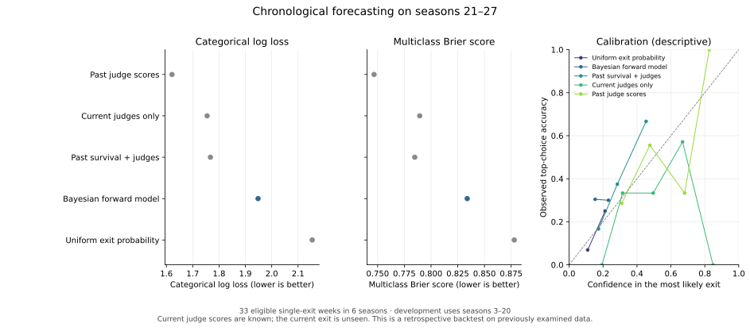
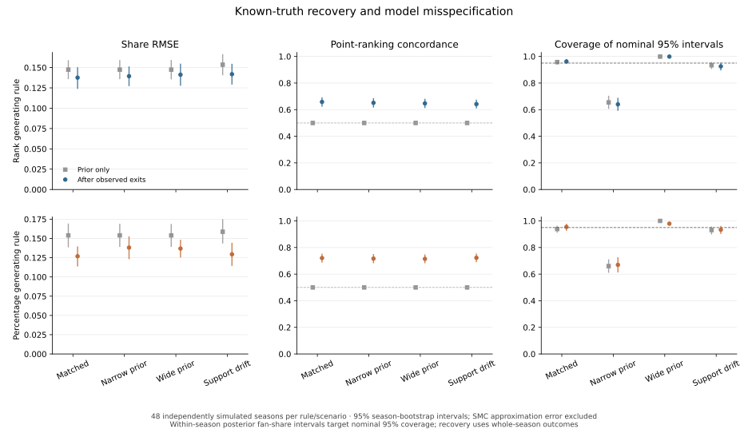
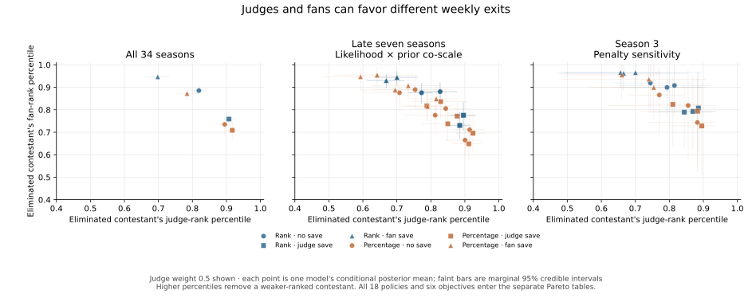

# Forecasting, recovery and voting-policy tradeoffs

Project lead: **Yike Chen**. The original DWTS study is credited to Team 2627761.
These experiments extend the current AI-assisted software edition; they are not
presented as competition-time results. [Provenance](PROVENANCE.md) describes the
research and implementation stages.

These three checks ask different questions: can a model forecast a later
elimination using only information available before that elimination, can known
simulated fan support be recovered, and do voting-policy comparisons survive
changes in objectives and modeling assumptions?

The forecast and recovery studies use a new **normalized categorical forward
model**, separate from the original report-style soft-penalty model. Its
sequential Monte Carlo (SMC) diagnostics describe particle degeneracy and
resampling; they are not MCMC convergence statistics. The policy study retains
the original fitted posterior and observed weekly rosters.

The real-data evaluation is a chronological backtest on an already examined
dataset. Chronology prevents information from later outcomes entering each
forecast; it does not turn the experiment into independent confirmation.

## 1. Forecasting before observing the weekly exit



Model selection uses seasons **3–20**; the primary evaluation uses seasons
**21–27**. Seasons 28–34 have a judge-save mechanism that this forecast model
does not represent and are outside the primary evaluation. Each probability
vector is scored before that week's observed exit enters the posterior. Current
judge scores are available at that point, so this is a forecast of the exit after
judging, not a forecast of the judges' performances.

The eligibility rule retains **33 nonfinal single-exit weeks across six
represented seasons**: 21, 22, 23, 24, 25 and 27. Season 26 has no eligible weeks
because its observed exits are multiple-exit events. Withdrawals, zero-exit and
multiple-exit weeks are excluded from the categorical exit score. This restricted
population is recorded in the [eligibility table](../results/forecast_study/eligibility_summary.csv).

The forward model assigns independent Normal priors to season-static support
logits. For each active roster, a softmax of negative voting merit produces a
proper categorical distribution over the next exit. SMC updates the season's
support distribution after each released single ordinary exit that meets the
roster and withdrawal conditions. Final-week metadata filters scoring only.
Future exits and
whole-season inferred fan shares are not inputs to earlier forecasts.

| Model | Log loss, nats ↓ | Multiclass Brier score ↓ | Top-choice accuracy |
|---|---:|---:|---:|
| Uniform exit probability | 2.1539 | 0.8779 | 9.1% |
| Current judge scores | 1.7546 | 0.7894 | 36.4% |
| Past survival + current judges | 1.7671 | 0.7847 | 36.4% |
| Own past judge scores | **1.6213** | **0.7466** | **39.4%** |
| Bayesian forward model | 1.9481 | 0.8339 | 30.3% |

The Bayesian model improves on uniform log loss by **−0.2057**, with a paired
95% season-bootstrap interval **[−0.2928, −0.1449]**. It scores worse than the
strong judge-history baseline on this backtest: Δ log loss **+0.3269**. The
corresponding interval **[−0.2955, +0.7016]** is wide with only six season
clusters. These results do not demonstrate predictive value beyond the strong
baseline or establish population-level inferiority. The latent model's added
complexity has not earned an accuracy claim.

All settings are selected on development seasons. The Bayesian choice is prior
standard deviation 0.5 and exit temperature 6. The survival baseline selects
history weight zero, so its final prediction uses current judge scores alone at
its selected temperature. The own-history baseline averages prior relative judge
scores, with current relative scores as a cold start. Top-choice ties use the
lexically first identifier; log loss is the primary metric. Calibration uses five
fixed confidence bins and is descriptive with this small population.

Main predictions average **three independent 2,048-particle runs**. The
independent three-run 4,096-particle check changes mean exit probabilities by
**0.00164** on average (maximum **0.01108**) and mean log loss by **0.00336**;
all four declared approximation thresholds pass. An additional 1,024-particle
sensitivity is published. Passing these checks supports numerical stability of
this run, not model validity or exact posterior convergence. Score intervals use
5,000 paired season resamples of fixed predictions, without refitting.

[Forecast metrics](../results/forecast_study/metrics.csv) ·
[Paired score differences](../results/forecast_study/paired_differences.csv) ·
[Development selections](../results/forecast_study/model_selection.csv) ·
[Particle assessment](../results/forecast_study/mc_assessment.json) ·
[Forecast protocol](../results/forecast_study/protocol.json)

## 2. Recovering support in known-truth simulated seasons



Each synthetic season starts with eight contestants and six sequential exits.
The generator draws latent support and judge-score trajectories before the first
exit; each generated exit determines the next active roster. Both rank and
percentage likelihoods are evaluated. Recovery uses the completed synthetic
season's outcomes, so this is a test of retrospective inference, separate from
the forward forecasts above.

Four scenarios compare a matched Normal prior, an inference prior with half or
twice the true standard deviation, and support that gradually drifts while the
inference model assumes season-static support. Matched, narrow and wide prior
checks use the same generated seasons. The prior-only baseline uses a uniform
point share and no observed exits; its interval draws are evaluated on the same
generated rosters.

The study generates **192 independent synthetic seasons**: 48 static and 48
drifting seasons for each rule family. Reusing each static season for three prior
settings gives **384 main inference fits**. Main fits use 4,096 particles, with
64 independent 8,192-particle sensitivity fits.

| Matched scenario | Uniform-share RMSE | Posterior share RMSE | Posterior-mean pairwise rank concordance | Mean 95% share-interval width |
|---|---:|---:|---:|---:|
| Percentage | 0.15394 | 0.12688 | 0.7209 | 0.4320 |
| Rank | 0.14745 | 0.13762 | 0.6584 | 0.5073 |

Point rankings order posterior-mean fan shares; expected concordance over
posterior draws is a separate exported metric. The point-ranking prior baseline
is 0.5 because its uniform shares tie every pair. Observed outcomes improve
average recovery, but vote-share intervals
remain broad. Narrowing the inference prior cuts coverage to **67.0%** for
percentage and **64.0%** for rank. The matched aggregate coverage values,
**95.5%** and **96.2%**, therefore do not establish robustness to prior error.
The drift scenario gives **93.4%** and **92.6%**, respectively.

Uncertainty bars resample **whole independent seasons**; contestant-week
rows within a season are dependent. A separate first-week check fixes contestant
0 before any simulation and reports a Wilson binomial interval across seasons.
That probe is covered in **45/48** percentage simulations (95% Wilson interval
**83.2–97.9%**) and **43/48** rank simulations (**77.8–95.5%**). Forty-eight
independent trials give limited precision for a nominal 95% coverage claim.
Coverage is a repeated-simulation property, not an accuracy probability assigned
to one observed vote estimate. Matched-prior coverage is marginal over the
declared generating prior, not a fixed-parameter guarantee.

These misspecification checks cover the declared prior and time-drift
alternatives; they do not establish robustness to every generating process.
The two rule families use different merit units, so the same numerical exit
temperature does not equalize information strength. A recovery difference
between rule families cannot be assigned to aggregation alone. The rank
likelihood is unchanged by positive rescaling of support logits; rank outcomes
alone therefore cannot identify the magnitude of true vote shares.

The independent particle checks also expose numerical limits. Across the 64
reruns, the largest root-mean-square difference between estimated posterior
mean shares is **0.0101**. A single simulated season's point-rank concordance
can change by **0.1325**. Simulation bootstrap bars omit this SMC approximation
error, and individual rankings should not be treated as numerically exact.

[Recovery summaries](../results/recovery_study/recovery_summary.csv) ·
[Fixed-probe coverage](../results/recovery_study/coverage_probe.csv) ·
[Particle sensitivity](../results/recovery_study/approximation_checks.csv) ·
[Recovery protocol](../results/recovery_study/protocol.json)

## 3. Comparing policy objectives and modeling assumptions



Voting-policy objectives can disagree. A Pareto comparison treats improvement in
one objective together with the cost in another; it does not prescribe a universal
definition of fairness. The six declared endpoints are related rather than
statistically independent:

| Endpoint | Preferred direction under the declared objective |
|---|---|
| Type A exit rate: judge top two, fan below the top half | Lower |
| Type B exit rate: fan top half, judge bottom two | Lower |
| Eliminated contestant's judge-rank percentile | Higher: a weaker judge rank exits |
| Eliminated contestant's fan-rank percentile | Higher: a weaker fan rank exits |
| Exit rate among the judge-ranked top half | Lower |
| Exit rate among the fan-ranked top half | Lower |

Ranks use 1 for best, average ranks for ties, and percentile `(rank − 1)/(n − 1)`.
The analysis compares **18 policies** using **2,048 joint posterior draws** on
each fixed roster. There are three separate cohorts:

| Cohort | Eligible rosters | Declared modeling scenarios |
|---|---:|---|
| All 34 seasons | 291 | Baseline fit |
| Seasons 28–34 | 63 | Two fitted elimination likelihoods × three joint prior co-scales |
| Season 3 | 8 | Penalty strength 0.1, 1 and 10 |

The late-season prior changes use exact posterior co-scale transport on rank-fit
seasons, not new MCMC fits. The figure shows the six judge-weight-0.5 policies;
all 18 policies enter the tables and comparisons. Each faint bar is one model's
marginal 95% credible interval, not a joint contour or an interval across
different assumptions.

For example, rank aggregation with a judge save reduces Type A exits from
**2.70% to 0.76%**, but raises Type B exits from **1.49% to 10.43%** in the
full-cohort baseline. The paired changes are **−1.94 percentage points**
(95% credible interval **[−3.44, −0.69]**) and **+8.93 points [5.50, 12.37]**.
The mean eliminated judge-rank percentile rises from **0.8190 to 0.9074**, while
the fan-rank percentile falls from **0.8852 to 0.7587**. Saving contestants favored
by one side shifts the cost to the other under these endpoints.

Of the **153 unordered policy pairs**, seven show six-endpoint mean dominance in
the full-cohort baseline. No pair keeps a dominance direction across every
scenario in either the late-season or Season 3 grid. **133/153** late-season
pairs and **146/153** Season 3 pairs remain tradeoffs in every scenario.

Robust dominance refers to the **conditional posterior means** in
every declared scenario within one cohort. Paired posterior dominance support
answers a separate within-model question. Scenarios receive no invented
probabilities and cohorts are not pooled.

Equal-weight rank aggregation without a save is **Pareto efficient by
construction for these six endpoints**. It maximizes the sum of eliminated
judge and fan rank percentiles on every roster and posterior draw. Its fan-logit
tie-break then chooses the weakest fan rank among tied rank sums. Matching both
mean percentiles therefore requires matching both eliminated ranks on every
draw and roster, which also matches all four threshold endpoints. An alternative
cannot improve an endpoint while leaving all five others no worse. This
efficiency does not mean that the reference dominates other policies or that its
tradeoffs are preferable. The separate 153-pair comparisons describe the finite
scenario grids; the reference's efficiency is not a new empirical finding.

These are one-exit decisions on fixed observed rosters. They do not simulate
complete alternative seasons, contestant adaptation or causal audience behavior.

[Six-objective summaries](../results/policy_robustness/policy_metrics.csv) ·
[Paired contrasts](../results/policy_robustness/policy_contrasts.csv) ·
[Pareto stability](../results/policy_robustness/pareto_stability.csv) ·
[Endpointwise worst cases](../results/policy_robustness/worst_case_metrics.csv) ·
[Policy protocol](../results/policy_robustness/protocol.json)

## Rerunning the checks

Install dependencies and obtain the official CSV through [RUNNING.md](RUNNING.md).
Use fresh output directories:

```bash
python -m dwts.forecasting --config configs/forecast_study.json --out outputs/my-forecast
python -m dwts.recovery_study --config configs/recovery_study.json --out outputs/my-recovery
```

The policy study requires the baseline chains and the three matched sensitivity
fits described in [STUDY_RESULTS.md](STUDY_RESULTS.md#interpretation-and-rerunning).
The sensitivity source paths are explicit in its configuration:

```bash
python -m dwts.policy_robustness --source outputs/my-study --config configs/policy_robustness_study.json --out outputs/my-policy-robustness
```

Regenerate the three figures directly from public aggregate tables:

```bash
python scripts/render_validation_results.py
```

Raw data, per-person forecasts and posterior draws remain outside the public
release. The protocols record configurations, implementation and input hashes;
the status files record artifact hashes. These checks make a run traceable and
do not expand the scientific scope of its results.
