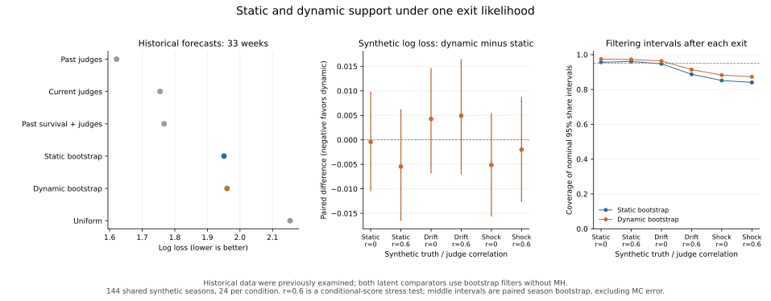

# Static and dynamic support comparison

This exploratory extension asks whether changing latent support improves exit
forecasts under the **same normalized observation model**. It uses previously
examined COMAP data. It is not independent prospective validation and cannot
measure accuracy against real individual fan votes. These new models and
experiments do not validate the original retrospective soft-constraint model.

```bash
dwts compare-support --data data/raw/2026_MCM_Problem_C_Data.csv \
  --config configs/dynamic_study.json --out outputs/dynamic-study-v2
```

The equivalent module command is `python -m dwts.dynamic_study` with the same
arguments. Use a new output directory on every run. Raw data, contestant-level
predictions, synthetic run rows and filtering diagnostics remain in ignored
`outputs/`; only the documented aggregate result files are published.

## Shared observation model and information clock

For current roster size `n`, judge scores `J`, and latent support logits `z`,
fan shares are `softmax(z)` and merit is

```
M_i = n * [w * J_i / sum(J) + (1-w) * softmax(z)_i]
P(exit=i) = softmax(-temperature * M)_i
```

This is a normalized categorical distribution for exactly one ordinary exit.
It is not the retrospective penalty likelihood renormalized after fitting.
The comparison keeps `w=0.5`. It excludes rank-era and judge-save seasons.

Every week consumes only the current roster and scores, advances latent state,
and records probabilities **before** releasing that week's ordinary exit or
withdrawal. Only one ordinary exit, no observed withdrawal, and at least three
active contestants updates the likelihood. Nonfinal weeks satisfying that same
gate are scored. Final flags only filter scoring. A skipped outcome does not
prevent current scores advancing the dynamic state. No final placement, future
roster, or whole-season fitted audience shares enter a forecast. The release
clock is reconstructed from historical labels, not externally timestamped.

## Controlled static and dynamic models

Both models give each newly observed contestant an independent
`Normal(0, prior_sd)` initial logit. Future contestants are never preallocated.
The static model keeps that logit unchanged. On subsequent appearances the
dynamic alternative follows

```
r_i,t = n_t * J_i,t / sum(J_t)
z_i,t = z_i,previous + drift * (r_i,t-r_i,previous)
        + Normal(0, process_sd * sqrt(elapsed_weeks))
```

`r_i,previous` is that contestant's last observed relative score, using the
roster of that previous week; it can change when roster composition changes.
At first appearance there is no additional transition noise or drift. Gaussian
noise integrates missing calendar weeks when a contestant reappears. Both
models condition on current scores; they do not model how judges produce them.

Inference is a bootstrap particle filter: sample the declared transition, weight
by the current normalized likelihood, and perform systematic resampling below
the fixed ESS threshold. There is **no Gaussian jitter after resampling** and
no static full-history MH target applied to a dynamic state. Zero noise and
zero drift reproduce static SMC with MH disabled, including RNG and weights.

The static comparator here has no MH moves. The earlier
[forecast study](VALIDATION_RESULTS.md) uses static resample-move SMC with full-history
MH and is a different finite-particle implementation. This experiment isolates
the transition under equal inference settings; it does not replace that earlier
result. Bootstrap particles can lose ancestral diversity, especially under
repeated selection. Process noise defines the transition and does not remove
all approximation concerns.

## Model selection and scoring

Seasons **3–20** select each latent model from the same nine
`prior_sd=[0.5,1,2]` × `temperature=[1,3,6]` candidates using development mean
log loss and deterministic input-order tie breaking. Development inference uses
three independent 512-particle runs per candidate, averaging probabilities before
scoring. The same seed ensemble is used for both models. Dynamic `process_sd=0.25` and `drift=1.0` are fixed before fitting;
there is no additional transition-parameter search. This is one prespecified
dynamic alternative. Matching initial scales does not force later support
variances to match.

Seasons **21–27** evaluate the selected models on the same 33 eligible weeks
across six represented seasons. Season 26 has no eligible weeks. The primary
comparison is dynamic minus static categorical log loss. Brier score, top-1
accuracy and fixed-bin calibration are secondary/descriptive. Lower log loss
and Brier are better. Whole-season paired percentile bootstrap intervals use
5,000 resamples of fixed predictions; they do not include refitting uncertainty,
SMC error or independent-data uncertainty. Six season clusters give limited
precision.

Uniform, current-judge, past-survival and own-past-judge baselines keep the
settings already selected using seasons 3–20 in the earlier forecast study.
In particular, the strong own-past-judge baseline uses the contestant's mean
past `n*judge_share`, with current relative score only for cold starts; its exit
temperature is 12. The evaluation results do not tune any model or baseline.

Main forecasts average three independently seeded 2,048-particle predictions.
Independent-seed 1,024- and 4,096-particle runs assess sensitivity. Frozen gates
are mean absolute probability difference ≤0.01, maximum difference ≤0.05,
absolute log-loss difference ≤0.025 (main versus higher-particle ensembles), and
main-repeat log-loss span ≤0.05. These checks are diagnostics, not proof of
posterior convergence or model validity. A failed gate must remain visible.

## Common synthetic seasons

The simulation has 144 independent seasons: three support processes × two
judge-support correlations × 24 replicates. Each starts with eight contestants
and has six categorical exits. Both methods fit exactly the same truth, scores,
rosters and sampled exits within each replicate. Neither method regenerates
its own favorable observations.

- **Static:** independent Normal initial support and no changes.
- **Drift:** the declared score-change drift and Gaussian state noise.
- **Shock:** otherwise static support with a randomly selected active
  contestant receiving a +2 logit shock in week three.

A persistent judge aptitude has correlation 0 or 0.6 with initial support.
The correlated case is a conditional-score stress test: an inference procedure
that treats scores as fixed inputs does not exploit their generative
correlation with initial support. All simulated methods use the generator's
fixed initial scale and exit temperature, not historical evaluation tuning.

The study reports pre-exit share RMSE, post-exit filtering share RMSE,
posterior-mean pairwise rank concordance, interval width, and mean weekly
marginal coverage of model-conditional 95% weighted empirical intervals.
These are **filtering**, not future-conditioned smoothing, results. Averages
weight each simulated week equally. They do not establish uniform fixed-truth
coverage, true-vote recovery in DWTS or calibration of the original model.
Paired simulated-season bootstrap intervals compare fixed particle estimates.
Main fits use 4,096 particles; the first three fixed replicates per condition
also have independently seeded 8,192-particle checks. Higher-particle differences
are reported separately from simulated-season sampling variation.

## Observed results

The completed three-seed development run selects `prior_sd=0.5`, temperature 6
for the static filter, and `prior_sd=2`, temperature 6 for the dynamic filter.
The historical evaluation gives:

| Model | Log loss | Brier | Top-1 |
|---|---:|---:|---:|
| Static bootstrap | 1.950881 | 0.834577 | 33.3% |
| Dynamic bootstrap | 1.960465 | 0.838328 | 33.3% |
| Own past judges | 1.621273 | 0.746650 | 39.4% |
| Uniform | 2.153861 | 0.877933 | 9.1% |

Dynamic minus static log loss is **+0.009584**, with a paired season-bootstrap
95% interval **[-0.010102, +0.025463]**. The comparison provides no evidence of a
dynamic improvement; the strong historical-judge baseline still has the best
point score. Both latent models pass all four declared historical MC gates.
These are limited approximation checks, not a performance superiority claim.



Across all six synthetic conditions, every dynamic-minus-static log-loss
interval includes zero. In the independent-score drift condition the dynamic
filter has a slightly smaller filtering share RMSE (0.1454 versus 0.1486), but
these small differences should not be advertised as numerically resolved.
On the fixed higher-particle check subset, the largest absolute differences are
0.02780 log loss, 0.00859 filtering share RMSE, and 4.46 percentage points of
mean weekly coverage. Shock intervals under-cover in both models: coverage is
approximately 87.3–88.3% for dynamic and 84.0–85.2% for static, despite nominal
95% model intervals. The synthetic study exposes the limits of this particular
transition; it does not establish a generally superior dynamic model.

## Reproducibility

[Aggregate results](../results/dynamic_study/) include historical metrics,
season metrics, paired differences, calibration, selection trials, eligibility,
particle sensitivity and MC assessment; synthetic metrics, paired differences
and sensitivity; and the frozen protocol and completed-run status. The protocol
records data/configuration/source hashes, package versions, selected parameters,
runtime and filter diagnostics. Private output hashes in the run status are
integrity evidence, not permission to distribute those files.

The dynamic-support and score-change idea was motivated by the inspected
[aidanhaya public project at a fixed commit](https://github.com/aidanhaya/DWTS-Fan-Vote-Estimator/blob/24942a3a77847009bce1502b4b3652da09f800e1/dynamic_model.py).
Our transition/filter implementation is independent and uses the shared
normalized categorical likelihood. No source code was copied. This comparison
makes no general methodological novelty or priority claim and is not a
head-to-head rerun of that project's original pipeline.
