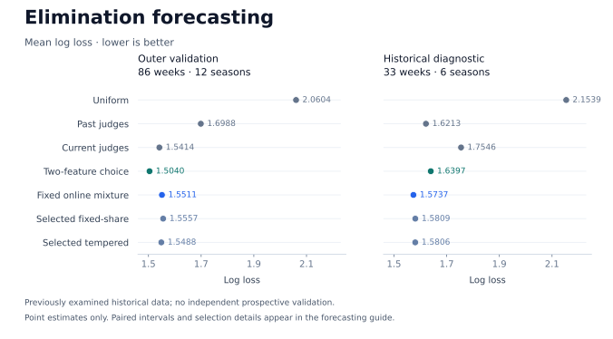

# Chronological elimination forecasting

[Project overview](../README.md) · [Run guide](RUNNING.md) · [Aggregate results](../results/exit_forecast_study/)

This study asks whether public judges' scores and past observed information can
predict an ordinary single elimination. It compares a small conditional choice
model, strong score baselines and standard online expert aggregation. It does
not infer or validate true audience vote totals.

The two-feature model has the best point score on the 86 outer-validation
events. A fixed online mixture has the best point score on a previously
examined 33-event diagnostic period. Extra adaptation has not established a
consistent improvement. All comparisons remain exploratory historical evidence.

## Target and information clock

An event is eligible when its roster has at least three contestants, it is not
a final, it contains exactly one ordinary elimination and no withdrawal. Every
method is scored on the same eligible event set. Season 26 contributes no
eligible events to the diagnostic period.

At each week the workflow:

1. Reads the complete current roster and judges' scores.
2. Builds features from current scores and previously released score histories.
3. Freezes a probability distribution over the current roster.
4. Releases the current outcome, scores the forecast and updates online weights.

This is a forecast conditional on current judges' scores, rather than a
prediction made before the performance. Score histories include all previously
released scores, including weeks whose outcomes are ineligible for scoring.
Online weights update only on eligible outcomes. Histories and mixture weights
reset at each season boundary; future participants, outcomes and placements
are excluded from current features.

## Models

For contestant `i` in a roster of size `n`, let `c_i` be `n` times the current
judge-score share. Let `h_i` be that contestant's mean previously released
relative score, using `c_i` at a cold start. These are simple public-score
features, not latent fan-share estimates.

| Method | Probability model |
|---|---|
| Uniform | Equal probability for every current contestant. |
| Current judges | `softmax(-temperature × c)`. |
| Past judges | `softmax(-temperature × h)`. |
| Two-feature conditional choice | `softmax(beta_current × c + beta_past × h)`, fitted by regularized categorical log loss. |

The conditional model centers each feature within the current roster. It uses
no intercept or learned full-dataset standardization. Centering leaves softmax
probabilities unchanged while making the feature convention explicit.

### Online mixtures

All mixtures use the four experts in the order **past judges, current judges,
two-feature choice, uniform**, with fixed initial weights `(0.5, 0.2, 0.2, 0.1)`.
The prediction is the arithmetic weighted average of expert probabilities.
Only after release of the observed exit `y` are weights updated:

```text
posterior_weight[k] ∝ current_weight[k] × expert_probability[k, y] ** eta
next_weight[k] = (1 - gamma) × posterior_weight[k] + gamma × initial_weight[k]
```

- **Fixed online mixture:** `eta = 1`, `gamma = 0`; no fitted meta-parameter.
- **Selected fixed-share:** `eta = 1`; select `gamma` from `[0, 0.05, 0.2]`.
- **Selected tempered:** `gamma = 0`; select `eta` from `[1, 0.5, 2]`.

The last two families are evaluated separately. The experiment does not select
between them using the outer or diagnostic scores. Bayesian aggregation and
fixed-share are established methods; see [method sources](RELATED_WORK.md#online-expert-aggregation).

## Chronological selection

The expert library uses five increasing training/forecast blocks. Only earlier
blocks fully contained in the current training range can select a parameter.

| Training seasons | Forecast seasons | Role |
|---|---|---|
| 3–5 | 6–8 | Initial inner-validation block. |
| 3–8 | 9–12 | Outer fold 1; later available to inner selection. |
| 3–12 | 13–16 | Outer fold 2; later available to inner selection. |
| 3–16 | 17–20 | Outer fold 3; later available to final selection. |
| 3–20 | 21–27 | Previously examined historical diagnostic. |

The three outer folds contain **86 eligible events in 12 seasons**. The final
diagnostic contains **33 events in six eligible seasons**. Its labels were
already examined in earlier project work, so it is not an untouched test set.

Baseline temperatures are selected on eligible training events from
`[0.25, 0.5, 0.75, 1, 1.5, 2, 3, 6, 12, 24]`. Conditional-model ridge values
`[0.0001, 0.001, 0.01, 0.1, 1]` are selected by pooled log loss on contained
chronological inner blocks. Training seasons 3–5 have no earlier validation
block, so their startup ridge is fixed at `0.001`.

Mixture meta-parameters use the same contained-block principle. The inner
sample sizes are 21, 51, 78 and 107 events at training cutoffs 8, 12, 16 and
20. Selection takes the first declared candidate within `1e-9` of the global
minimum. Expert weights reset at every validation season.

| Training cutoff | Selected fixed-share gamma | Selected tempered eta |
|---|---:|---:|
| 8 | 0 | 2 |
| 12 | 0.2 | 2 |
| 16 | 0.05 | 2 |
| 20 | 0.2 | 2 |

See the published [protocol](../results/exit_forecast_study/protocol.json) and
[selection records](../results/exit_forecast_study/selection.json) for the
machine-readable definitions and fitted settings.

## Results

Mean categorical log loss is the primary score; lower is better. Brier score,
top-1 accuracy and five-bin calibration error are secondary descriptions.
Top-1 ties, including uniform forecasts, use deterministic lexical contestant-ID
order.

| Method | Outer log loss | Diagnostic log loss | Outer accuracy | Diagnostic accuracy |
|---|---:|---:|---:|---:|
| Uniform | 2.060391 | 2.153861 | 12.79% | 9.09% |
| Past judges | 1.698769 | 1.621273 | 34.88% | 39.39% |
| Current judges | 1.541434 | 1.754607 | 43.02% | 36.36% |
| Two-feature choice | **1.504050** | 1.639680 | **44.19%** | 39.39% |
| Fixed online mixture | 1.551126 | **1.573701** | 41.86% | **42.42%** |
| Selected fixed-share | 1.555699 | 1.580872 | 41.86% | **42.42%** |
| Selected tempered | 1.548785 | 1.580645 | 43.02% | 39.39% |



The outer result favors the direct two-feature predictor over the latent
approaches previously evaluated in the project, but its advantage over the
current-score baseline remains uncertain. The fixed online mixture trades some
outer performance for a better diagnostic point score. Its improvement over
past judges in that diagnostic period occurs in only two of six seasons and
is concentrated in season 27. It is not evidence of uniform seasonal gains.

Selected paired log-loss comparisons quantify these differences:

| Candidate / baseline / evaluation | Mean difference | 95% paired season-bootstrap interval |
|---|---:|---:|
| Two-feature choice / current judges / outer | −0.037385 | [−0.098004, +0.017391] |
| Fixed online / past judges / outer | −0.147643 | [−0.262726, −0.047728] |
| Fixed online / past judges / diagnostic | −0.047572 | [−0.291604, +0.078090] |

The added adaptation does not resolve this limitation. Paired log-loss
differences relative to the fixed online mixture are:

| Candidate / evaluation | Mean difference | 95% paired season-bootstrap interval |
|---|---:|---:|
| Fixed-share / outer | +0.004573 | [−0.006482, +0.019779] |
| Fixed-share / diagnostic | +0.007171 | [−0.001001, +0.015164] |
| Tempered / outer | −0.002342 | [−0.014979, +0.008563] |
| Tempered / diagnostic | +0.006944 | [−0.007740, +0.025817] |

Negative differences favor the candidate. All four intervals span zero. The
small outer point gain for tempered updating is accompanied by worse diagnostic
log loss; neither extension demonstrates a consistent replacement for the
simpler online mixture.

Bootstrap samples resample whole paired seasons and retain event weighting
within each sample. These intervals condition on the fitted predictions. They
exclude uncertainty from refitting, hyperparameter selection and repeated
historical exploration. With only six diagnostic seasons, their precision and
interpretation are limited.

## What the cumulative bounds mean

For the fixed online mixture, each season satisfies the standard log-loss
bound against the past-judges expert:

```text
L_mixture <= L_past + log(2)
```

The constant comes from that expert's initial weight of `0.5`. It is paid
again after every season reset. The bound concerns cumulative log loss for
the same realized sequence, rather than better accuracy, calibration or
expected future performance.

With fixed-share, the corresponding no-switch-path bound for `T` eligible
events is weaker:

```text
L_mixture <= L_past + log(2) - (T - 1) * log(1 - gamma)
```

For no-share tempered updating with `0 < eta <= 1`, the declared bound is
`L_mixture <= L_past + log(2) / eta`. The selected `eta = 2` is outside that
range and does not retain this guarantee. Only `eta = 1, gamma = 0` has the
standard exact Bayesian marginal-likelihood identity used by the fixed mixture.

## Run and inspect

```bash
# Self-contained workflow with invented observations
python -m dwts.exit_study --demo --out outputs/exit-forecast-demo

# Historical study; obtain the official CSV separately
python -m dwts.exit_study --data data/raw/2026_MCM_Problem_C_Data.csv --config configs/exit_forecast_study.json --out outputs/exit-forecast-study
```

Read the [run guide](RUNNING.md#chronological-elimination-forecasting) for data
handling and the distinction from the earlier latent forecasting study.
The public bundle contains [metrics](../results/exit_forecast_study/metrics.csv),
[paired comparisons](../results/exit_forecast_study/paired_differences.csv),
[season summaries](../results/exit_forecast_study/season_metrics.csv),
[selection](../results/exit_forecast_study/selection.json),
[protocol](../results/exit_forecast_study/protocol.json) and a
[run summary](../results/exit_forecast_study/summary.json). Individual forecasts
and raw source records remain outside the published results.

## Interpretation

All data in these experiments had previously been examined, and earlier
results informed later hypotheses. The chronological design prevents direct
use of a target fold's labels in its fitting and selection; it cannot remove
the effects of repeated research decisions. There is no independent prospective
validation yet. Predicting eliminations also cannot validate the unobserved
audience shares or establish causal effects of judges, partners or rule changes.

The contribution is an explicit application and controlled empirical comparison,
including retained negative findings, rather than a claim of a new aggregation
algorithm. These are subsequent extensions of Team 2627761's study; see
[research provenance](PROVENANCE.md).
