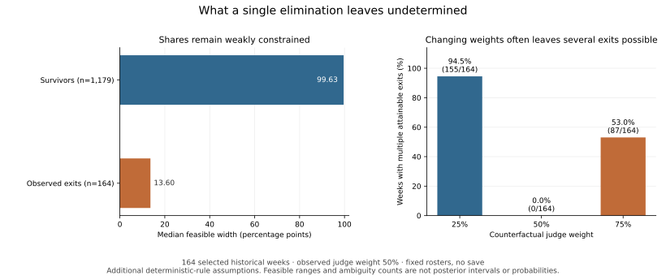

# Identification and rule-weight attainability

Audience votes are unobserved. This study asks what weekly vote shares are
compatible with a declared deterministic rule, and whether changing its judge
weight uniquely determines the eliminated contestant. It uses linear
optimization rather than posterior sampling.

The [COMAP problem statement](https://www.contest.comap.com/undergraduate/contests/mcm/contests/2026/problems/2026_MCM_Problem_C.pdf)
describes fan votes as unknown and confidential, and supplies hypothetical
vote allocations to illustrate aggregation. Its historical discussion leaves
the precise return to rank aggregation uncertain and proposes season 28 as an
assumption. The seasons 3–27 scope here follows the project's declared
percentage-rule convention; this analysis does not establish the exact
historical rule transition.

## Additional assumptions and population

For one fixed observed weekly roster, let `j` be normalized judge scores and
`p` unknown fan shares. The combined merit is

```text
M_i(w,p) = w*j_i + (1-w)*p_i,   0<w<1.
```

Assume the contestant with the lowest combined merit exits, with no save.
For the observed exit `e`, the closed feasible region is

```text
p_i >= 0,  sum_i p_i = 1,
M_e(w,p) <= M_k(w,p) for every survivor k.
```

**This deterministic restriction is an additional modeling assumption.** The
historical soft-constraint likelihood penalizes violations, while the
normalized stochastic forward model assigns positive exit probabilities.
Neither probabilistic model implies this hard region. The resulting bounds
are not posterior credible intervals, actual vote recovery, or a test that
either posterior must pass. No prior or posterior chains enter this study.

The [frozen configuration](../configs/identification_study.json) sets original
judge weight `0.5`, candidate seasons 3–27, `label_first` outcome preparation,
and counterfactual weights `0.25`, `0.5`, `0.75`. Eligible weeks are nonfinal,
have at least three active contestants, contain no withdrawal, and have
exactly one ordinary exit. Exclusions are reported both as overlapping flags
and as mutually exclusive counts in the declared filter order. There is no
rescue mechanism, multiple-exit interpretation, or season rollout.

Judge shares use the mean of available judge scores for each contestant,
normalized across the active roster. This convention is explicit rather than
silently substituting score totals. The separately obtained official CSV is
not distributed in this repository.

## Sharp coordinate bounds and ties

For every contestant separately, minimize and maximize `p_i` over the full
region. Each endpoint has its own feasible share-vector witness. These
coordinate intervals form an outer box; their endpoints generally cannot be
combined into one feasible allocation.

The optimization includes zero shares and combined-merit ties, without
imposing a boundary tie-break rule. It therefore returns attained extrema of
the **closed weak-inequality region**. A separate common-margin optimization
requires `p_i>=delta` and every observed elimination gap `>=delta`. A strictly
positive margin certifies a positive-share configuration with a unique
observed exit. Mixing this interior point with any endpoint witness shows
that the closed endpoints are also the infima/suprema over that strict
region. The endpoints themselves need not be attained under a specified
tie-break convention. When no positive margin is certified, that strict-region
interpretation is not asserted.

There is an independent analytic check. Define

```text
d_s = w/(1-w) * (j_e-j_s),  s != e,
D = sum_s max(0,d_s).
```

The region is nonempty exactly when `D<=1`. For `n>=3`, the eliminated lower
endpoint is zero and each survivor has

```text
L_s = max(0,d_s),
U_s = 1-D+max(0,d_s).
```

The eliminated upper endpoint is the unique nonnegative root

```text
t + sum_s max(0,t+d_s) = 1.
```

Thus all survivor interval widths within a week equal `1-D`. The code checks
each LP endpoint against these formulas and an independent monotone scalar
root. The two-person API case uses `L_survivor=1-U_e`; the `n>=3` formula
cannot be used without another survivor to absorb leftover mass. Tests also
check a two-person hand calculation, infeasible and boundary-only regions,
constructive witnesses, and permutation equivariance.

## Joint counterfactual support

To test a candidate exit `c` under a different weight `w_new`, maximize one
common `delta` over a **single** full share vector subject to:

```text
sum_i p_i = 1, p_i >= delta,
M_k(w_original,p) - M_e(w_original,p) >= delta for all k != e,
M_k(w_new,p) - M_c(w_new,p) >= delta for all k != c.
```

A candidate is certified attainable when `delta>1e-8`, the configured
numerical threshold. A weakly infeasible LP excludes it even from the closed
joint region. A zero margin corresponds to boundary-only feasibility;
positive margins at or below the threshold are reported separately and not
counted. Margin and residual diagnostics accompany the aggregate results.
These numerical checks are certificates within declared solver tolerances,
not symbolic exact-arithmetic proofs.

Each attainable candidate may have a different witness. Support counts are
set cardinalities, **not outcome probabilities**. A single certified candidate
is a numerically unique supported exit at the declared threshold; any
below-threshold positive margins remain separately unresolved. Multiple
certified candidates show that the original observation does not determine
that comparison. These counts do not measure which rule is better.
The unchanged weight is a logical oracle: in a nonempty strict original
region, only the originally observed exit can also be a unique exit under
that same rule.

Observed weekly rosters remain fixed throughout. A changed elimination would
affect future rosters; those downstream effects are outside this study.

## Run and inspect

From a checkout with dependencies installed and the separately obtained CSV:

```bash
python -m dwts.identification \
  --data data/raw/2026_MCM_Problem_C_Data.csv \
  --config configs/identification_study.json \
  --out outputs/identification-study-v1
```

The unified CLI also accepts `dwts identify` with the same arguments. An
existing output directory is refused. Configuration rejects unknown fields,
unsupported filters, duplicate weights, and an omitted unchanged-weight
oracle. Source and input hashes are frozen before fitting and rechecked
before marking a run complete. Installation does not require working from
the checkout; supply explicit paths for the config and CSV when elsewhere.

Only these aggregate artifacts are intended for
[public results](../results/identification_study):

| File | Contents |
| --- | --- |
| `protocol.json` | Assumptions, filters, configuration, source hashes and dependency versions |
| `width_summary.csv` | Separate survivor/exit/all summaries; contestant-week, week and season weighting stated |
| `eligibility_summary.csv` | Candidate and eligible counts; overlapping and ordered exclusions |
| `policy_ambiguity.csv` | Per-weight counts and fractions of weeks with multiple certified candidate exits |
| `policy_candidate_counts.csv` | Per-weight distribution of the number of certified candidate exits |
| `numerical_checks.json` | LP counts/statuses, witness residuals, analytic-check discrepancies and strict margins |
| `status.json` | Completion status, source hashes and explicit publication allowlist |

`private_bounds.csv`, `private_weekly.csv`, and
`private_policy_candidates.csv` contain individual identifiers and constructive
allocations. They are written with owner-only permissions under the selected
local output directory and are excluded from publication. Use the ignored
`outputs/` directory in a checkout; do not copy these files into `results/`.
The command does not publish or copy any output automatically.

## Current finite-sample results

The configured official-data study contains **164 eligible weeks across 24
seasons**, covering **1,343 contestant-weeks**. Median feasible share width is
approximately **0.9963 for survivors** and **0.1360 for observed exits**.
Pooling these populations would obscure their different information content.
A width of `0.9963` means 99.63 percentage points of possible share, not a
confidence level. These are finite-sample descriptions conditional on the
declared deterministic rule, without population confidence intervals.



| Counterfactual judge weight | Weeks with multiple attainable unique exits | Mean candidate count |
| --- | ---: | ---: |
| 0.25 | 155/164 (94.51%) | 6.500 |
| 0.50 | 0/164 | 1.000 |
| 0.75 | 87/164 (53.05%) | 2.177 |

The broad regions show how little one observed exit can determine by itself
under these assumptions. Extreme feasible allocations need not be realistic;
excluding them requires additional information or assumptions. This result
does not establish a novel general identification theorem, validate private
vote totals, or replace the separate stochastic-model recovery and forecast
studies.
